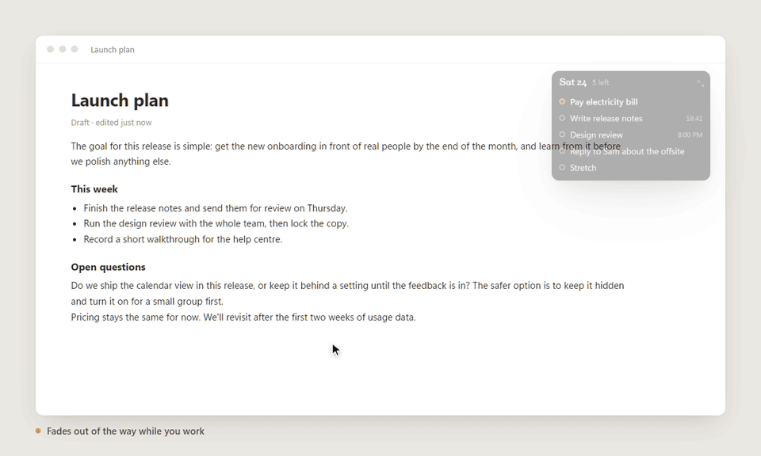
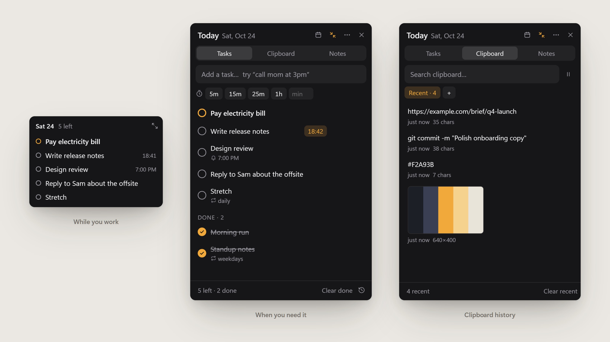
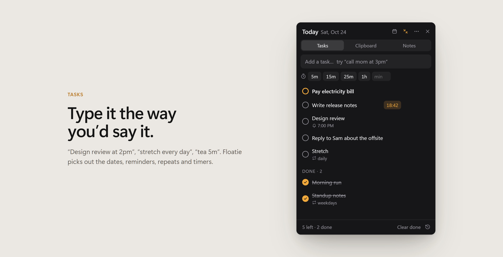
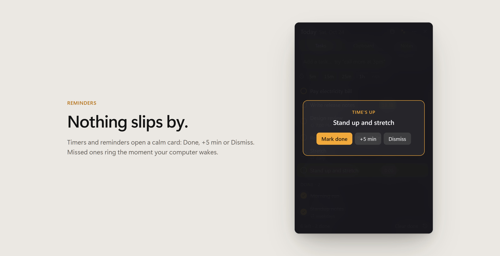
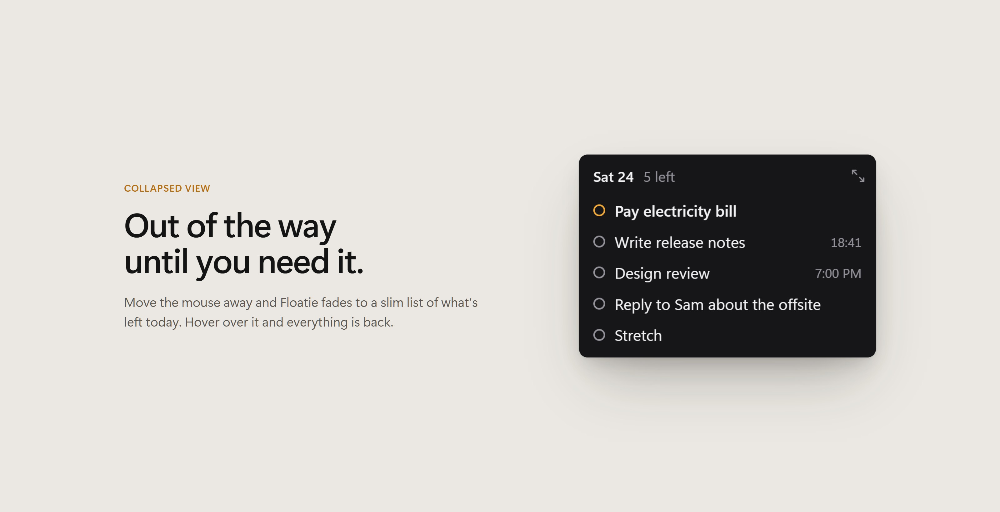
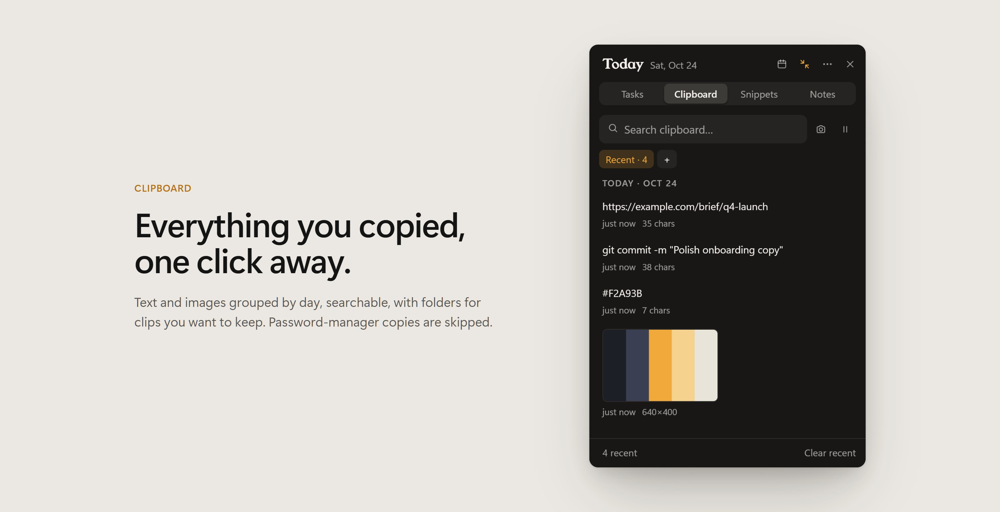
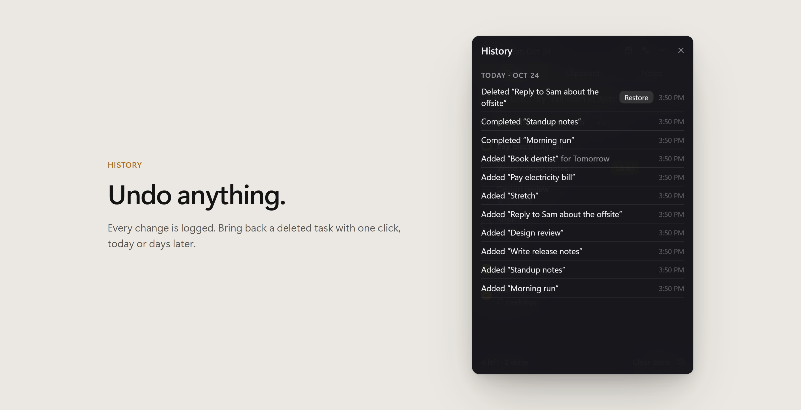
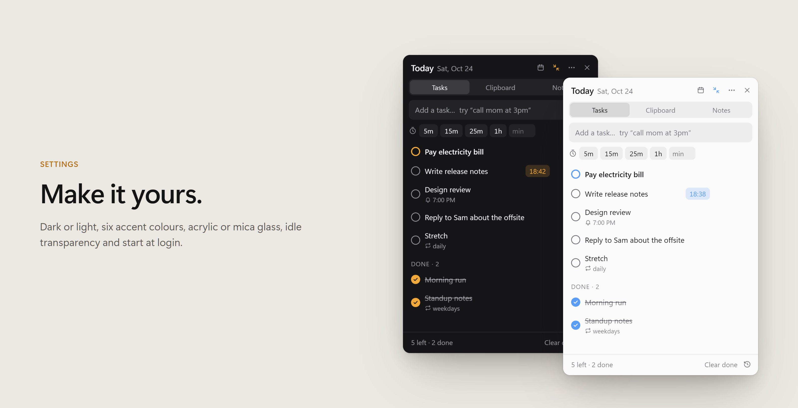

# Floatie

**A tiny always-on-top widget for today's tasks, timers, reminders, notes and clipboard history.**
It stays out of the way: when your mouse leaves, it fades and shrinks to a slim list of what's left today. Hover it and the full panel comes back.





- **Type tasks like you'd say them:** `call mom at 3pm`, `stretch every day`, `standup weekdays at 9`, `pay rent fri!`, `tea 5m`.
- **Built-in timers:** one click on 5m, 15m, 25m or 1h, or add `25m` to any task.
- **Reminders that don't get lost:** if one comes due while your PC is asleep or the app is closed, it fires as soon as you're back.
- **Clipboard history with folders:** search it, pin snippets into folders, keep images. Password-manager copies are skipped.
- **Notes scratchpad** for whatever doesn't fit a task.
- **Undo everything:** a history panel lets you restore anything you deleted.
- **Calm by design:** glass background, fades to see-through when idle, no pop-up toasts.
- **Your data stays on your computer.** No account, no cloud, no tracking. Saves survive power cuts, with daily backups.

Windows 10/11 and macOS 12+ · free and open source (MIT)

## Install

**Windows:** open PowerShell and paste:

```powershell
irm https://raw.githubusercontent.com/ZirkoMirkoLabs/floatie/main/install.ps1 | iex
```

**macOS:** open Terminal and paste:

```bash
curl -fsSL https://raw.githubusercontent.com/ZirkoMirkoLabs/floatie/main/install.sh | bash
```

Run the same command again to update. Your tasks and clipboard history are kept.

If you'd rather click through an installer, download it from [**Releases**](https://github.com/ZirkoMirkoLabs/floatie/releases/latest): `Floatie-Setup-x.y.z.exe` for Windows, or the `.dmg` for macOS (`arm64` for Apple Silicon, `x64` for Intel).

> **"Windows protected your PC" / "Apple cannot check it for malicious software"?** The builds aren't code-signed yet, so the OS doesn't recognise the publisher.
> - Windows: click **More info → Run anyway**.
> - macOS (.dmg): right-click Floatie in Applications → **Open** → **Open**.
>
> The one-line installers above handle this for you.

## How to use it

**1. Add tasks.** Click the box (or press `Ctrl+K`) and type. Floatie picks out the details:

| You type | You get |
|---|---|
| `call mom at 3pm` | a reminder at 3:00 PM today |
| `dentist tomorrow at 10` | tomorrow, reminder at 10:00 AM |
| `review report fri` | on the next Friday |
| `stretch every day` / `standup weekdays` / `team sync weekly` | a repeating task |
| `tea 5m` / `focus 25m` / `deep work 1.5h` | a task with a countdown timer |
| `pay rent!` | a starred (highlighted) task |

Click the circle to finish a task. Click a timer to pause it. When a timer or reminder is up, Floatie shows a card with **Mark done**, **+5 min** and **Dismiss**.





**2. Let it shrink.** Move the mouse away and Floatie fades and collapses to just today's list. Rest the mouse on it, or click it, to bring it back. Drag the edges to resize; it remembers where you put it.



**3. Clipboard tab.** Everything you copy shows up here, text and images. Click an item to copy it again. Use **+** to make folders for snippets you reuse. **⏸** pauses recording.



**4. Other days.** The 📅 button shows the week; `Alt+←` / `Alt+→` move between days and `T` jumps back to today. Unfinished tasks roll over to the next day on their own.

**5. Oops?** `Ctrl+Z` undoes the last change, and the history panel (`Ctrl+H`) can restore anything you deleted today or earlier.



**6. Make it yours.** **⋯ → Settings** has start at login, keep on top, auto-collapse, hover or click to expand, glass style, idle fade and visibility, theme, accent colour, sound, and backup export/import.



### Shortcuts

| | |
|---|---|
| Show / hide from anywhere | `Ctrl+Alt+Space` (macOS: `⌘⇧Space`)* |
| New task | `Ctrl+K` or `/` |
| Undo / history | `Ctrl+Z` / `Ctrl+H` |
| Tasks / Clipboard / Notes | `Ctrl+1` / `2` / `3` |
| Previous / next day, today, week | `Alt+←` `Alt+→` `T` `W` |
| Collapse now | `Ctrl+M` |

On a Mac, use `⌘` for `Ctrl`. \* If another app already uses that combination, Floatie picks a free one (e.g. `Ctrl+Shift+Space`) and shows it in the tray menu and under **⋯ → Shortcuts & tips**.

## Your data

Everything is saved locally, in `%APPDATA%\floatie` on Windows and `~/Library/Application Support/floatie` on macOS. Floatie makes no network requests of its own; **Update** just opens this page's latest release.

- Each save goes to a temp file first and is then swapped into place, so a crash or power cut can't corrupt it.
- It keeps a last-good copy plus a dated backup for each of the last 14 days.
- If the data file can't be read at startup (say, antivirus is scanning it), Floatie waits and retries. It never starts empty over real tasks.
- **Settings → Export backup / Import backup** moves your data to another computer.

## Build from source

You'll need Node.js 20+ and npm.

```bash
git clone https://github.com/ZirkoMirkoLabs/floatie.git
cd floatie
npm ci
npm start          # run it
npm test           # 51 automated checks in hidden windows (they never touch your real data)
npm run dist:win   # Windows installer → dist/   (run on Windows)
npm run dist:mac   # macOS .dmg + .zip → dist/   (run on a Mac)
```

On Windows, `powershell -ExecutionPolicy Bypass -File install-from-source.ps1` runs it from the source folder and adds Desktop and Start Menu shortcuts. With a git checkout, **Update** runs `git pull` and restarts.

**Releasing:** push a tag such as `v1.2.0`. GitHub Actions ([release.yml](.github/workflows/release.yml)) builds the Windows and macOS installers and attaches them to a Release.

Built with Electron and plain HTML/CSS/JS: no framework and no runtime dependencies.

| File | What it does |
|---|---|
| `main.js` | window, collapse/expand and fade, tray, clipboard watcher, storage |
| `platform.js` | everything that differs between Windows and macOS |
| `preload.js` | the small API the page is allowed to call |
| `app.js`, `index.html`, `style.css` | the UI: tasks, parsing, calendar, alarms, clipboard, notes, history, settings |
| `test/` | the hidden test harness |
| `tools/readme-shots/` | regenerates these README images from the real app: `node tools/readme-shots/make.js` |

## Status

Windows is used daily and fully tested. macOS support is new: the code and builds are in place, but it hasn't had much real-world use yet. Bug reports are welcome in [Issues](https://github.com/ZirkoMirkoLabs/floatie/issues).

## License

[MIT](LICENSE)
